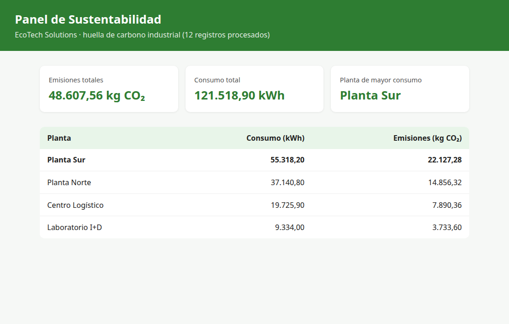

# EcoTech Solutions · Evaluación técnica de desarrollo

Trabajo Práctico Final del curso **C3 | Programación con Python** (IPAP Mendoza).

**Autor:** Claudio Luna

El proyecto está dividido en tres ejercicios independientes, cada uno en su carpeta:

| Carpeta | Ejercicio | Temas del curso aplicados |
|---|---|---|
| [`ejercicio_1_sensores/`](ejercicio_1_sensores/) | Sanitización y análisis estadístico de sensores | Strings, diccionarios, listas por comprensión, tuplas, funciones, manejo de excepciones |
| [`ejercicio_2_productos/`](ejercicio_2_productos/) | Modelo de productos, excepciones y persistencia | POO, encapsulamiento (`@property`), herencia, polimorfismo, excepciones personalizadas, JSON con `with` |
| [`ejercicio_3_auditoria_web/`](ejercicio_3_auditoria_web/) | Auditoría con tests unitarios e integración web | `unittest`, módulos y paquetes, Django (vista basada en función y plantilla) |

## Requisitos

- Python 3.10 o superior
- Django 5.2 (solo para el Ejercicio 3)

```bash
python -m venv .venv
source .venv/bin/activate        # En Windows: .venv\Scripts\activate
pip install -r requirements.txt
```

## Ejercicio 1 · Sensores

```bash
cd ejercicio_1_sensores
python sensores.py               # demo: limpieza de registros crudos y reporte final
python -m unittest -v            # 8 tests
```

- `limpiar_registro_sensor(registro_raw)` quita espacios del ID, convierte la temperatura a `float` (acepta `"24.5C"`, `"31.2 °C"` o `"28,7C"`) y asigna `"Sin ubicación"` cuando falta el dato. Si la temperatura no es numérica eleva `ValueError` y la demo descarta ese registro.
- `generar_resumen_sensores(lista_sensores_limpios, umbral_temperatura)` devuelve la tupla `(lista_sensores_alerta, promedio_temperatura)`.

## Ejercicio 2 · Productos

```bash
cd ejercicio_2_productos
python main.py                   # demo: fichas, captura de StockInvalidoError y exportación
python -m unittest -v            # 7 tests
```

| Módulo | Contenido |
|---|---|
| `excepciones.py` | `StockInvalidoError` |
| `dispositivos.py` | `DispositivoEcológico` (stock privado `__stock` validado por `@property`) y `PanelSolar` (hereda y redefine `ficha_tecnica()`) |
| `gestor.py` | `GestorInventario.guardar_catalogo_json(lista_dispositivos, ruta_archivo)` |
| `main.py` | Bloque de prueba que genera `catalogo_ecotech.json` |

El archivo [`catalogo_ecotech.json`](ejercicio_2_productos/catalogo_ecotech.json) que se incluye es la salida de `main.py`.

## Ejercicio 3 · Auditoría y panel web

```bash
cd ejercicio_3_auditoria_web
python manage.py test -v 2       # 13 tests (unittest + integración con Django)
python manage.py runserver       # abrir http://127.0.0.1:8000/
```

| Archivo | Contenido |
|---|---|
| `sustentabilidad/emisiones.py` | `calcular_emisiones_carbono(consumo_kwh, factor_emision=0.4)`; eleva `ValueError` si el consumo es negativo |
| `sustentabilidad/tests.py` | `TestCalculoEmisiones(unittest.TestCase)`, más pruebas de las métricas y de la vista |
| `sustentabilidad/metricas.py` | `obtener_metricas_consumo(registros)`: total global de emisiones, planta de mayor consumo y detalle por planta |
| `sustentabilidad/views.py` | `vista_panel_sustentabilidad(request)`: vista basada en función que arma el contexto |
| `sustentabilidad/templates/sustentabilidad/panel.html` | Plantilla del panel |
| `sustentabilidad/data/consumos.json` | Historial simulado de consumos por planta (agosto a octubre de 2026) |

La auditoría del algoritmo (Punto A) también corre con `unittest` puro, sin levantar Django:

```bash
python -m unittest sustentabilidad.tests.TestCalculoEmisiones -v   # 6 tests
```



## Estructura

```
.
├── ejercicio_1_sensores/
│   ├── sensores.py
│   └── test_sensores.py
├── ejercicio_2_productos/
│   ├── excepciones.py
│   ├── dispositivos.py
│   ├── gestor.py
│   ├── main.py
│   ├── test_productos.py
│   └── catalogo_ecotech.json
├── ejercicio_3_auditoria_web/
│   ├── manage.py
│   ├── ecotech_panel/          # configuración del proyecto Django
│   └── sustentabilidad/        # app: algoritmo, métricas, vista, plantilla y tests
├── docs/
├── requirements.txt
└── README.md
```
